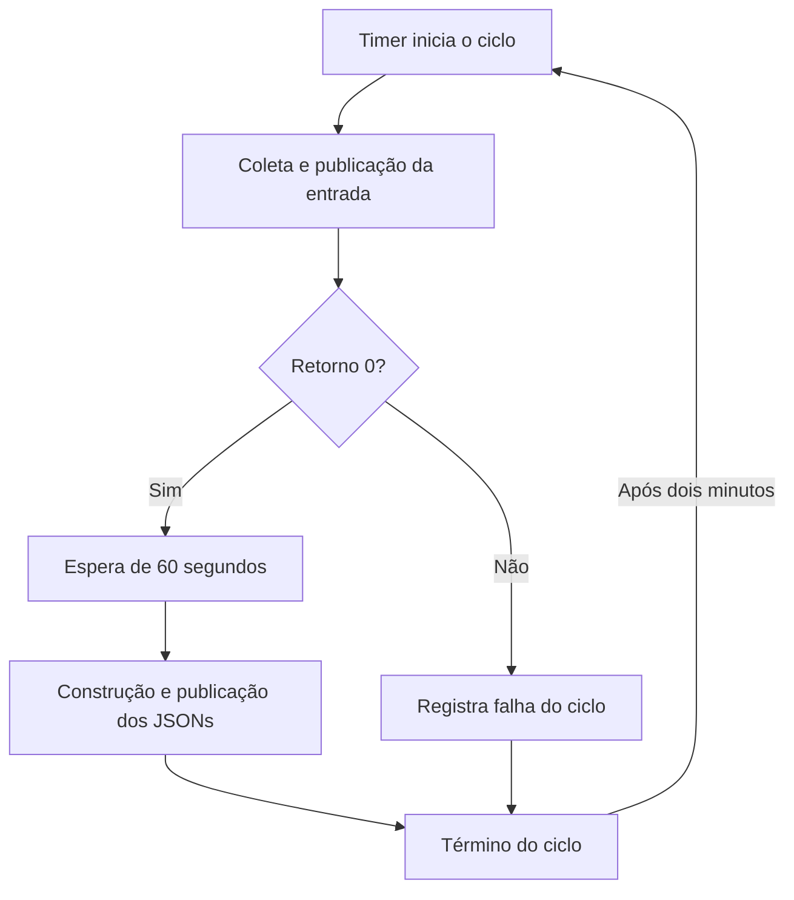

# Operação da esteira Dell Unity no RHEL 8 e RHEL 9

Atualização: **05/10/2026**. Este guia descreve a instalação em operação.
Coletor de referência: `2026.10.03-paralelo`.

A esteira utiliza somente `storage-pipeline.service` e `storage-pipeline.timer`.
O serviço executa coleta, espera de 60 segundos e construção dos JSONs.
O timer mantém uma pausa de dois minutos depois do término do ciclo completo.
A instalação atual executa os scripts como `root`; a API utiliza `zabbix_api`.

## Índice

1. [Arquitetura em operação](#1-arquitetura-em-operação)
2. [Fluxo e critérios de sucesso](#2-fluxo-e-critérios-de-sucesso)
3. [Caminhos, equipamentos e API](#3-caminhos-equipamentos-e-api)
4. [Configuração das duas unidades](#4-configuração-das-duas-unidades)
5. [Entrada, temporários e publicação](#5-entrada-temporários-e-publicação)
6. [Operação diária](#6-operação-diária)
7. [Manutenção da configuração](#7-manutenção-da-configuração)
8. [Falhas e diagnóstico](#8-falhas-e-diagnóstico)
9. [Validação realizada no RHEL 8.7](#9-validação-realizada-no-rhel-87)
10. [Duração e crescimento do inventário](#10-duração-e-crescimento-do-inventário)
11. [Contas, permissões e documentação do código](#11-contas-permissões-e-documentação-do-código)

## 1. Arquitetura em operação

| Elemento | Responsabilidade e configuração atual |
| --- | --- |
| `storage-pipeline.service` | Executar os três comandos em sequência, com `Type=oneshot`. |
| `storage-pipeline.timer` | Acionar o serviço; primeiro gatilho por `OnActiveSec=2min` e ciclos seguintes por `OnUnitInactiveSec=2min`. |
| Coletor | Consultar os equipamentos cadastrados, com `--workers 4`, e publicar uma entrada consolidada. |
| Construtor | Ler a entrada, executar todos os `ACTIVE_HANDLERS` por equipamento e publicar os JSONs finais. |
| API | Entregar o JSON do equipamento na rota consultada pelo Zabbix. |
| Zabbix | Consultar a API conforme o intervalo configurado no item HTTP. |

**Somente o timer é habilitado no systemd.** O serviço é acionado pelo timer ou por uma execução manual através de `systemctl start storage-pipeline.service`.

O agendamento abrange coleta e construção. O paralelismo acontece dentro do coletor, entre equipamentos; o construtor começa depois que a coleta termina e a espera de 60 segundos acaba.

## 2. Fluxo e critérios de sucesso

O serviço contém três linhas `ExecStart`, nesta ordem:

1. O coletor consulta todos os equipamentos cadastrados e publica `input_events.json` quando a entrada consolidada está pronta.
2. `/bin/sleep 60` aguarda 60 segundos após a coleta.
3. O construtor lê a entrada completa e publica o JSON correspondente a cada equipamento.

O serviço termina depois do último comando ou quando uma etapa falha. A pausa de dois minutos é contada após o término do serviço inteiro.



Com `Type=oneshot`, vários `ExecStart` são executados em sequência. Se um comando retornar erro, as etapas seguintes são puladas e a unidade registra falha. O modelo não usa prefixos para ignorar esses erros. Referência: [systemd.service do RHEL 8](https://redhat-plumbers.github.io/systemd-rhel8/systemd.service.html).

O coletor pode concluir com equipamentos indisponíveis ou métricas sem suporte. Portanto, retorno `0` significa que produziu um ciclo publicável; a saúde dos equipamentos deve ser avaliada no conteúdo e na qualidade dos dados. Uma falha global do coletor impede a execução do construtor naquele ciclo.

O término do serviço indica o fim da execução dos scripts. A leitura pela API ou pelo Zabbix ocorre separadamente, conforme a configuração dessas aplicações.

Uma solicitação de início da mesma unidade enquanto ela já executa não cria outra instância paralela. Para ciclos completos, utilize o serviço. Chamadas diretas aos scripts não recebem a coordenação da unidade systemd.

## 3. Caminhos, equipamentos e API

| Elemento | Caminho da instalação atual |
| --- | --- |
| Coletor | `/opt/storage_monitor/coletor_unity_input_events.py` |
| Módulo de autenticação e inventário | `storage_api_manager`, no ambiente Python utilizado pelo coletor |
| Configuração opcional do coletor | `/opt/storage_monitor/config_unity.json` |
| Entrada consolidada | `/opt/storage_monitor/input_events.json` |
| Construtor | `/opt/storage_monitor/constructor_json_nas.py` |
| Raiz das saídas | `/zabbix_api/app/data/devices` |
| Serviço | `/etc/systemd/system/storage-pipeline.service` |
| Timer | `/etc/systemd/system/storage-pipeline.timer` |

Os exemplos usam `/usr/bin/python3`. Se o ambiente de autenticação utiliza um virtualenv, ajuste os dois comandos Python do serviço para o mesmo interpretador.

O arquivo `config_unity.json` é opcional no coletor, mas está referenciado no modelo desta instalação. Se não for utilizado em outro ambiente, retire somente `--config /opt/storage_monitor/config_unity.json` do comando do coletor. A quantidade de equipamentos vem do cadastro utilizado pelo motor.

### Equipamento, modelo e arquivo de saída

O nome lógico identifica o equipamento e determina o destino do JSON. O modelo físico, como Dell Unity XT 380F ou XT 480F, é uma informação do equipamento.

A entrada deve conter um objeto por equipamento cadastrado. O construtor executa os **25 `ACTIVE_HANDLERS` por equipamento** e gera um arquivo consolidado para cada um.

O destino segue esta regra:

```text
<output-dir>/<family>/<name>/public/done-<name>.json
```

Para a família `unity` e o nome `nome_do_dispositivo_unity`:

```text
/zabbix_api/app/data/devices/unity/nome_do_dispositivo_unity/public/done-nome_do_dispositivo_unity.json
```

O argumento `--output-dir /zabbix_api/app/data/devices` direciona a publicação para a árvore utilizada pela API.

### Consulta pela API

Para o equipamento cadastrado como `unity-01`, o padrão de consulta permanece:

```bash
curl -fsS -X GET 'http://192.168.122.61/devices/unity/unity-01' \
  -H "x-api-token: ${ZABBIX_API_TOKEN}"
```

Defina `ZABBIX_API_TOKEN` com o token real antes do teste. Para outro equipamento, use o identificador correspondente à rota da sua API.

No template HTTP do Zabbix, configure por host a URL do equipamento em `{$API_URL}` e o token em `{$API_TOKEN}`, conforme o template importado. Uma resposta HTTP bem-sucedida deve ser acompanhada pela verificação da data dos dados e da qualidade da coleta.

## 4. Configuração das duas unidades

### 4.1. storage-pipeline.service

Arquivo: `/etc/systemd/system/storage-pipeline.service`.

```ini
# Esteira completa: coleta, espera de 60 segundos e construcao dos JSONs.
# Operacao e manutencao descritas em OPERACAO_Unity_RHEL_Systemd.md.
[Unit]
Description=Esteira Dell Unity: coleta e publicacao dos JSONs
Wants=network-online.target time-sync.target
After=network-online.target time-sync.target

[Service]
Type=oneshot
# Preserva a conta e o contexto de autenticacao da instalacao atual.
User=root
Group=root
WorkingDirectory=/opt/storage_monitor
Environment=PYTHONUNBUFFERED=1
Environment=PYTHONIOENCODING=utf-8
# 1. Coleta todos os equipamentos e publica a entrada atomicamente.
ExecStart=/usr/bin/python3 /opt/storage_monitor/coletor_unity_input_events.py --config /opt/storage_monitor/config_unity.json --output /opt/storage_monitor/input_events.json --workers 4
# 2. Mantem a espera existente, depois da coleta e antes do construtor.
ExecStart=/bin/sleep 60
# 3. Confirme os argumentos no --help do construtor instalado.
ExecStart=/usr/bin/python3 /opt/storage_monitor/constructor_json_nas.py --input /opt/storage_monitor/input_events.json --output-dir /zabbix_api/app/data/devices
# Limite de inicializacao; revise com o inventario e a duracao das etapas.
TimeoutStartSec=1h
TimeoutStopSec=15s
KillMode=control-group
Restart=no
RemainAfterExit=no
StandardOutput=journal
StandardError=journal
SyslogIdentifier=storage-pipeline
```

`User=root`, `Group=root` e `WorkingDirectory=/opt/storage_monitor` mantêm o contexto de autenticação utilizado na instalação validada.

`PYTHONUNBUFFERED=1` permite que mensagens Python sejam enviadas ao journal sem esperar o encerramento do processo. O journal recebe a saída do coletor, do construtor e as mensagens do systemd.

A espera de 60 segundos é o segundo `ExecStart`. Colocá-la em `ExecStartPre` faria essa espera ocorrer antes da coleta.

`RemainAfterExit=no` permite que a unidade termine depois dos comandos. `Restart=no` deixa as novas tentativas sob responsabilidade do timer. `KillMode=control-group` inclui os processos filhos na parada do serviço.

`TimeoutStartSec=1h` é uma salvaguarda de inicialização; não define a frequência das coletas. Revise o limite quando aumentar o inventário ou a duração das etapas. Mantenha também os limites internos do coletor compatíveis com links lentos e equipamentos indisponíveis.

`After/Wants=network-online.target time-sync.target` define a ordenação de partida. A comunicação com cada Unity continua sendo verificada pelo coletor; a sincronização de horário depende da configuração de tempo do servidor.

### 4.2. storage-pipeline.timer

Arquivo: `/etc/systemd/system/storage-pipeline.timer`.

```ini
[Unit]
Description=Executa a esteira Dell Unity dois minutos apos o ciclo anterior

[Timer]
# Gatilho inicial apos a ativacao do timer.
OnActiveSec=2min
# Proximos ciclos: dois minutos depois do termino do servico completo.
OnUnitInactiveSec=2min
AccuracySec=1s
Unit=storage-pipeline.service

[Install]
WantedBy=timers.target
```

`OnActiveSec=2min` fornece o gatilho inicial relativo à ativação do timer. `OnUnitInactiveSec=2min` usa o término do serviço como referência para os próximos ciclos. As duas expressões estão ativas; um término manual recente também pode influenciar o próximo horário.

`AccuracySec=1s` reduz a janela de agrupamento do disparo. Pequenas diferenças de horário são esperadas, e a carga do servidor pode acrescentar atraso.

Esta configuração usa intervalos relativos. Após reinicialização ou reativação do timer, consulte `list-timers` para conferir o próximo disparo; não há uma fila de coletas perdidas durante a parada.

Referência: [systemd.timer do RHEL 8](https://redhat-plumbers.github.io/systemd-rhel8/systemd.timer.html).

## 5. Entrada, temporários e publicação

Durante a coleta, `input_events.json` permanece com a versão anterior. Os resultados por equipamento são preparados em arquivos temporários ocultos. Depois de reunir e validar os resultados, o coletor publica a entrada consolidada por substituição atômica.

| Arquivo ou diretório | Comportamento |
| --- | --- |
| Temporários por equipamento | Ocultos, com acesso restrito, dentro do diretório de trabalho da coleta. |
| Temporário da entrada consolidada | Oculto, preparado no mesmo diretório do destino. |
| `input_events.json` | Substituído somente quando a entrada consolidada estiver pronta. |
| Lock do coletor | Coordena a coleta/publicação para o mesmo destino; sua presença no disco não indica, por si só, uma execução ativa. |
| JSON final por equipamento | Preparado pelo construtor e publicado no diretório `public` do dispositivo. |

A entrada pode receber uma nova data **antes de o serviço terminar**: sua publicação acontece ao fim da coleta; depois ainda há a espera de 60 segundos e a construção.

A escrita atômica protege cada arquivo contra leitura incompleta. As saídas de equipamentos diferentes são publicadas em sequência. Uma falha do construtor pode deixar algumas saídas atualizadas e outras com a versão anterior.

Na referência atual, temporários do coletor usam permissões restritas. Uma entrada nova recebe `0644`; quando o destino já existe, os bits de permissão são preservados. A substituição do arquivo não garante manter proprietário, grupo ou ACLs do inode anterior. Confira a leitura efetiva dos JSONs pela conta `zabbix_api` após a publicação.

Uma interrupção forçada pode deixar temporários. Faça a inspeção com o serviço parado. A remoção do arquivo de lock durante a coleta compromete sua coordenação; verifique o processo e o bloqueio em vez de usar somente a existência do arquivo como sinal.

## 6. Operação diária

### 6.1. Consultar estado e próximo disparo

```bash
systemctl status storage-pipeline.timer storage-pipeline.service --no-pager
systemctl list-timers --all storage-pipeline.timer
systemctl show storage-pipeline.service \
  -p ActiveState -p SubState -p Result -p ExecMainStatus
```

| Estado | Interpretação |
| --- | --- |
| Timer `enabled` | Configurado para iniciar com o sistema. |
| Timer `active (waiting)` | Aguardando o próximo disparo. |
| Serviço `activating (start)` | Coletando, aguardando os 60 segundos ou executando o construtor. |
| Serviço `inactive (dead)` após sucesso | Estado normal entre ciclos para este serviço `oneshot`. |
| Serviço `failed` | Alguma etapa falhou; consulte o journal. |

Durante uma execução, o próximo horário do timer pode ainda não aparecer. Confira novamente depois que o serviço terminar.

### 6.2. Executar um ciclo completo manualmente

```bash
systemctl start storage-pipeline.service
```

O comando aguarda a execução completa. Se o serviço já estiver executando, não solicita um segundo ciclo paralelo.

Depois, consulte o resultado e os logs:

```bash
systemctl show storage-pipeline.service -p Result -p ExecMainStatus
journalctl -u storage-pipeline.service --since '-20 minutes' --no-pager
```

Em uma execução concluída com sucesso, espera-se:

```text
Result=success
ExecMainStatus=0
```

A mensagem `Starting ...` marca o início do ciclo. Neste serviço `oneshot`, `Succeeded.` e `Started ...` aparecem depois que os comandos terminam; a mensagem `Started` não representa outra coleta.

Complemente a conferência dos códigos de saída com a atualização da entrada, dos JSONs finais e a consulta à API.

### 6.3. Acompanhar os logs

```bash
journalctl -u storage-pipeline.service --since today --no-pager
journalctl -u storage-pipeline.service -f
```

Use `Ctrl+C` para encerrar o acompanhamento. Isso não para o timer nem o serviço.

### 6.4. Pausar novos ciclos

Para uma pausa temporária, mantendo a habilitação no próximo boot:

```bash
systemctl stop storage-pipeline.timer
```

Para uma manutenção que também deve manter o agendamento desabilitado após um reboot:

```bash
systemctl disable --now storage-pipeline.timer
```

Parar o timer suspende novos acionamentos; um ciclo já iniciado continua até terminar. Antes de editar arquivos utilizados pelos scripts, espere o término e confira:

```bash
systemctl show storage-pipeline.service -p ActiveState -p SubState -p Result
```

Prossiga com a edição quando não houver execução em andamento. Um estado `failed` exige conferir o motivo no journal antes do próximo teste.

Se for necessário interromper o ciclo atual, use a parada do serviço:

```bash
systemctl stop storage-pipeline.service
```

Essa parada pode ocorrer durante coleta, espera ou construção. Verifique a entrada, as saídas e eventuais temporários antes de retomar.

### 6.5. Retomar o agendamento

```bash
systemctl enable --now storage-pipeline.timer
systemctl list-timers --all storage-pipeline.timer
```

Somente o timer recebe `enable`. O serviço é acionado pelo timer e permanece sem habilitação própria.

## 7. Manutenção da configuração

### 7.1. Conferir a configuração efetiva

```bash
systemctl cat storage-pipeline.service storage-pipeline.timer
systemctl show storage-pipeline.service \
  -p User -p Group -p WorkingDirectory -p ExecStart
```

O resultado de `systemctl cat` também mostra eventuais drop-ins. Compare os comandos efetivos com os caminhos do ambiente, principalmente o destino do coletor e a entrada do construtor.

Confira o interpretador e os argumentos antes de trocar versões dos scripts:

```bash
cd /opt/storage_monitor
/usr/bin/python3 coletor_unity_input_events.py --version
/usr/bin/python3 coletor_unity_input_events.py --help
/usr/bin/python3 constructor_json_nas.py --help
/usr/bin/python3 -c 'import storage_api_manager; print("Motor disponível")'
```

O construtor instalado deve aceitar `--input` e `--output-dir`. O modo normal do coletor deve consultar o cadastro completo; modos como `--host`, `--catalog-only` e `--list-handlers` são usados para diagnóstico ou inspeção.

### 7.2. Alterar argumentos, workers ou pausa

1. Pause o timer e aguarde o serviço terminar, conforme a seção 6.4.
2. Guarde uma cópia das duas unidades e dos seus drop-ins.
3. Edite o arquivo necessário.
4. Valide, recarregue e faça um ciclo manual com o timer parado.
5. Confira dados e API; depois retome o timer.

Exemplo de backup das unidades atuais, na mesma sessão Bash:

```bash
unity_backup_dir="/root/storage-pipeline-backup-$(date +%Y%m%d-%H%M%S)"
install -d -m 0700 "$unity_backup_dir"

cp -a /etc/systemd/system/storage-pipeline.service \
  /etc/systemd/system/storage-pipeline.timer "$unity_backup_dir/"

for unity_unit in storage-pipeline.service storage-pipeline.timer; do
  if test -d "/etc/systemd/system/${unity_unit}.d"; then
    cp -a "/etc/systemd/system/${unity_unit}.d" "$unity_backup_dir/"
  fi
done

systemctl cat storage-pipeline.service storage-pipeline.timer \
  > "$unity_backup_dir/configuracao-efetiva.txt"
```

Depois da edição, valide os arquivos. Consulte o código imediatamente após o comando:

```bash
systemd-analyze verify \
  /etc/systemd/system/storage-pipeline.service \
  /etc/systemd/system/storage-pipeline.timer
printf 'Código de saída: %s\n' "$?"
```

Com a validação concluída, recarregue e execute o teste:

```bash
systemctl daemon-reload
systemctl start storage-pipeline.service
systemctl show storage-pipeline.service -p Result -p ExecMainStatus
journalctl -u storage-pipeline.service --since '-20 minutes' --no-pager
```

Confira os JSONs e a consulta à API. Depois retome o agendamento:

```bash
systemctl enable --now storage-pipeline.timer
systemctl list-timers --all storage-pipeline.timer
```

Para alterar o paralelismo, ajuste `--workers 4` no comando do coletor. A referência aceita de 1 a 32 workers, e o argumento prevalece sobre `max_parallel_devices` no config. Aumente gradualmente, comparando duração, erros e carga nos equipamentos.

Para mudar a pausa, ajuste `OnUnitInactiveSec` no timer. `OnActiveSec` controla o gatilho relativo à ativação do timer. A espera entre coleta e construção continua sendo a linha `/bin/sleep 60` do serviço.

Se um drop-in substituir `ExecStart`, use primeiro `ExecStart=` vazio e depois declare os três comandos completos, na ordem correta. O [guia de permissões](PERMISSOES_Unity_RHEL.md) contém um exemplo.

Para recuperar uma configuração da própria esteira, mantenha o timer parado, espere o serviço terminar e restaure as unidades e os drop-ins do backup correspondente. Confira a configuração efetiva, valide, recarregue e faça um ciclo manual antes de retomar.

### 7.3. Reaplicar os arquivos do pacote

Use esta etapa somente quando precisar instalar novamente as definições de referência. Uma instalação que já funciona não precisa reinstalar as unidades apenas para receber esta documentação.

Depois de pausar o timer, aguardar o serviço e guardar a configuração efetiva, entre na pasta que contém os arquivos entregues e ajuste os caminhos ao seu ambiente:

```bash
install -o root -g root -m 0644 storage-pipeline.service \
  /etc/systemd/system/storage-pipeline.service

install -o root -g root -m 0644 storage-pipeline.timer \
  /etc/systemd/system/storage-pipeline.timer
```

Confira os drop-ins existentes, pois eles continuam compondo a configuração efetiva. Faça a validação, o teste manual e a retomada descritos na seção 7.2.

## 8. Falhas e diagnóstico

| Situação | Conferência e comportamento esperado |
| --- | --- |
| Sessão, rede ou timeout em um Unity | O coletor segue com os demais. Confira a qualidade dos eventos e os detalhes de comunicação. A correção externa da sessão continua fora do coletor. |
| Campo `null` ou qualidade `unsupported` | A métrica não tem uma fonte validada; não interprete como zero ou como saúde normal. |
| Falha global do coletor | O serviço registra falha e pula a espera/construção. A entrada anterior é preservada quando a falha ocorre antes da publicação. |
| Entrada publicada, mas construtor não executado | Confira retorno do coletor e a etapa registrada no journal; erro após publicação também pode impedir a construção. |
| Erro depois da substituição da entrada | Uma falha de sincronização do diretório pode retornar erro mesmo com o arquivo publicado. Confira mensagens como `publicado=true`. |
| Coletor recusou outro acesso ao destino | Confira o lock e a origem da execução adicional. |
| `ModuleNotFoundError` ou autenticação global falhou | Confira conta, interpretador, diretório, variáveis e acesso ao `storage_api_manager`. |
| Construtor falhou | Confira o journal e os arquivos por equipamento; parte das saídas pode ter sido publicada. |
| JSON final em outro diretório | Confira `--output-dir` e o caminho efetivo da saída. |
| API entrega dados desatualizados | Confira nome lógico, arquivo servido, timestamp, permissões, montagens e eventual cache. |
| Timer sem um próximo horário visível | Confira se o serviço ainda executa e consulte novamente depois do término. |

O journal e o campo `Result` devem ser lidos juntos. `ExecMainStatus` isolado não descreve todos os comandos da esteira.

| Retorno do coletor | Significado na referência |
| --- | --- |
| `0` | Ciclo publicável, inclusive com equipamentos indisponíveis ou métricas sem suporte. |
| `1` | Falha global de execução ou publicação. |
| `2` | Argumentos inválidos. |

### 8.1. Diagnóstico de um equipamento

Para inspecionar um Unity, use o nome lógico, IP ou FQDN cadastrado. Execute no mesmo contexto de autenticação do serviço e evite consultas simultâneas ao host quando houver restrições de sessão.

```bash
/usr/bin/python3 /opt/storage_monitor/coletor_unity_input_events.py \
  --config /opt/storage_monitor/config_unity.json \
  --host nome_do_dispositivo_unity -v
```

`-v` mostra os endpoints completos e os campos consultados.

```bash
/usr/bin/python3 /opt/storage_monitor/coletor_unity_input_events.py \
  --config /opt/storage_monitor/config_unity.json \
  --host nome_do_dispositivo_unity -vv
```

`-vv` acrescenta as respostas do equipamento e exige a seleção de um host. O modo diagnóstico consulta o Unity sem substituir a entrada consolidada da rotina.

Os detalhes podem ter grande volume e conter informações do ambiente. Use a saída para investigar a fonte da métrica e os retornos do equipamento.

### 8.2. Conferir a publicação

```bash
stat /opt/storage_monitor/input_events.json

stat /zabbix_api/app/data/devices/unity/nome_do_dispositivo_unity/public/done-nome_do_dispositivo_unity.json

/usr/bin/python3 -m json.tool \
  /zabbix_api/app/data/devices/unity/nome_do_dispositivo_unity/public/done-nome_do_dispositivo_unity.json \
  > /dev/null
```

Troque o nome do exemplo pelo equipamento cadastrado. `stat` mostra a atualização do arquivo; `json.tool` confere a sintaxe JSON. A avaliação de disponibilidade das métricas e da saúde depende do conteúdo.

Teste também a rota real da API, conforme a seção 3. Isso confirma o acesso através da aplicação, além da existência do arquivo local.

## 9. Validação realizada no RHEL 8.7

Esta seção registra as saídas fornecidas pelo operador em **05/10/2026**, no servidor de testes `zabbix-api-py`. Os horários estão em **America/Sao_Paulo (-03)**.

| Componente | Versão ou resultado apresentado |
| --- | --- |
| Sistema operacional | Red Hat Enterprise Linux 8.7 (Ootpa) |
| systemd | `239-68.el8` |
| irqbalance | `1.9.0-3.el8` |
| Verificação conjunta do serviço e timer | Código de saída `0` |
| Equipamentos no ciclo apresentado | 4 |
| Handlers informados na conclusão | 25 por equipamento |
| Timer | `enabled` e `active (waiting)` |

### 9.1. Sequência observada

| Evento | Horário e evidência |
| --- | --- |
| Início manual do serviço | 07:01:29, mensagem `Starting ...`. |
| Fim do ciclo manual | 07:02:30, mensagem de sucesso para 4 equipamentos e `Succeeded.`. |
| Ativação do timer | 07:03:51. |
| Próximo disparo exibido pelo timer | 07:05:51. |
| Início automático efetivo | 07:05:52. |
| Atualização observada da entrada | `input_events.json` passou a mostrar a data de modificação às 07:05. |
| Fim do ciclo automático | 07:06:52, mensagem de sucesso e `Succeeded.`. |
| Previsão do ciclo seguinte pela configuração | Aproximadamente 07:08:52; esse início não aparece no trecho de logs apresentado. |

A execução manual durou aproximadamente 1min01s; o primeiro ciclo automático, aproximadamente 1min. Essas durações incluem a espera configurada de 60 segundos e refletem o ambiente de testes.

A entrada publicada às 07:05 e a conclusão às 07:06:52 são compatíveis com a sequência coleta, espera e construção. O próximo intervalo deve ser conferido comparando o término de um ciclo com o início do seguinte no journal.

Os registros confirmam a verificação das unidades, a execução manual e o primeiro ciclo automático. A atualização dos JSONs finais e sua entrega pela API devem ser conferidas pelos comandos das seções 3 e 8.2.

### 9.2. Aviso de ConditionCPUs

A verificação apresentou:

```text
/usr/lib/systemd/system/irqbalance.service:6: Unknown lvalue 'ConditionCPUs' in section 'Unit'
Código de saída: 0
```

As versões do teste correspondem ao problema registrado pela Red Hat no pacote `irqbalance-1.9.0-3.el8`: ele inclui uma condição não reconhecida pelo systemd 239. A correção foi registrada no `irqbalance-1.9.0-4.el8`. O aviso não apontou erro nas unidades da esteira, e a verificação terminou com sucesso.

Trate a atualização desse pacote na manutenção do RHEL, usando os repositórios apropriados ao servidor. A correção desse aviso não requer alterar as duas unidades da esteira.

Referência: [Red Hat Bug 2115230](https://bugzilla.redhat.com/show_bug.cgi?id=2115230).

## 10. Duração e crescimento do inventário

A pausa de dois minutos é acrescentada ao tempo do ciclo inteiro:

```text
Duração do ciclo = coleta + 60 segundos + construção
Intervalo entre inícios = duração do ciclo + aproximadamente 120 segundos
```

| Duração do ciclo inteiro | Pausa | Intervalo aproximado entre inícios |
| --- | --- | --- |
| 1 minuto | 2 minutos | 3 minutos |
| 4 minutos | 2 minutos | 6 minutos |
| 7 minutos | 2 minutos | 9 minutos |
| 12 minutos | 2 minutos | 14 minutos |

A medição fornecida para **31 equipamentos e quatro workers**, de **06:42:39 a 06:45:25**, corresponde a **2min46s de coleta**. Aplicando essa medição à configuração atual:

```text
Intervalo entre inícios = 2min46s + 1min de espera + construção + 2min de pausa
                       = 5min46s + duração real do construtor
```

Essa referência e o teste de quatro equipamentos representam ambientes distintos. A duração real depende dos equipamentos, links, sessões e respostas da API Unity.

Uma coleta mais longa adia o próximo início porque o timer toma como referência o término da esteira. O serviço único evita ciclos simultâneos acionados pela mesma unidade.

Quatro workers consultam até quatro equipamentos em paralelo. Ter 32 cores no servidor não altera esse número automaticamente; a quantidade é definida pelo argumento/configuração do coletor.

Na referência do coletor, os limites padrão documentados são:

| Operação | Limite |
| --- | --- |
| Teste inicial de comunicação | 30 segundos |
| Chamada REST | 30 segundos |
| Coleta de um equipamento | 300 segundos |
| Subprocesso OpenSSL | 15 segundos, sujeito também ao prazo do equipamento |

Revise os limites do coletor e `TimeoutStartSec` conforme o inventário crescer. Links lentos e falhas podem aumentar a duração, mesmo com paralelismo.

A idade dos dados no Zabbix depende da duração da coleta/construção, da pausa e do intervalo HTTP do item. Use timestamps e qualidade dos eventos para avaliar a atualização das informações.

## 11. Contas, permissões e documentação do código

Na instalação atual:

- `root` mantém os scripts, a configuração e as unidades, e executa coleta e construção.
- `zabbix_api` executa a API e precisa ler os JSONs publicados.
- A entrada e os temporários ficam em `/opt/storage_monitor`.
- As saídas do Unity ficam na árvore `/zabbix_api/app/data/devices/unity`.

A propriedade do código pode continuar com `root` mesmo que, futuramente, uma conta dedicada execute os scripts. Essa mudança exige validar o contexto de autenticação do motor e os acessos aos diretórios.

O [guia de contas e permissões](PERMISSOES_Unity_RHEL.md) descreve a instalação atual e uma opção de conta dedicada `storage_monitor`. A opção mantém as mesmas duas unidades e os mesmos caminhos da API, alterando a conta e a localização dos dados de trabalho.

Para a manutenção das funções de consulta e dos handlers, consulte também `README_Coletor_Unity.md` e `MANUTENCAO_Coletor_Unity.md` da entrega do coletor.

Esta revisão atualiza a documentação operacional e um comentário do modelo de serviço. Os comandos, intervalos e scripts Python permanecem com a configuração validada.

## Referências

- [systemd.service do RHEL 8, systemd 239](https://redhat-plumbers.github.io/systemd-rhel8/systemd.service.html)
- [systemd.timer do RHEL 8, systemd 239](https://redhat-plumbers.github.io/systemd-rhel8/systemd.timer.html)
- [systemctl do RHEL 8](https://redhat-plumbers.github.io/systemd-rhel8/systemctl.html)
- [Red Hat: aviso ConditionCPUs no irqbalance do RHEL 8](https://bugzilla.redhat.com/show_bug.cgi?id=2115230)
- [Contas e permissões da esteira](PERMISSOES_Unity_RHEL.md)
